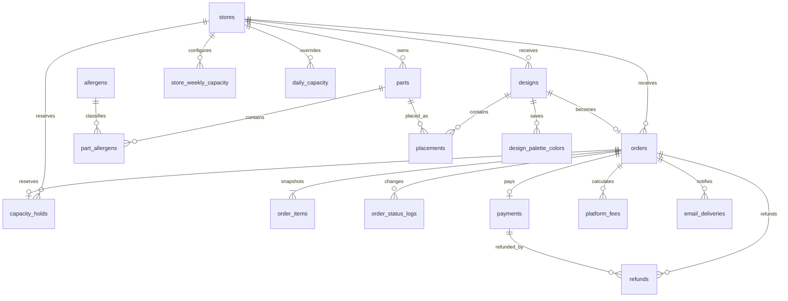
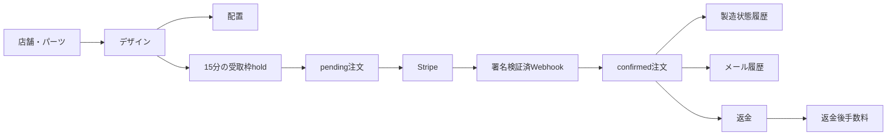

# ER 図

列・制約の詳細は [04-database-design.md](./04-database-design.md) を参照する。

## 主な属性

```mermaid
erDiagram
    stores {
      string id PK
      string slug UK
      string code UK
      string name
    }
    parts {
      string id PK
      string store_id FK
      string name
      string asset_key
      string kind
      int unit_price
    }
    allergens {
      string id PK
      string code UK
      string name
    }
    part_allergens {
      string part_id PK,FK
      string allergen_id PK,FK
    }
    designs {
      string id PK
      string store_id FK
      string sponge_color
      string cream_color
      string message_text
      int version
      datetime locked_at
    }
    placements {
      string id PK
      string design_id FK
      string part_id FK
      int seq_no
      float position_x
      float position_y
      float position_z
      float rotation_x
      float rotation_y
      float rotation_z
      float scale
      string color "nullable; required for border_decoration"
    }
    design_palette_colors {
      string id PK
      string design_id FK
      string color
      int sort_order
      datetime created_at
      datetime updated_at
    }
    orders {
      string id PK
      string store_id FK
      string design_id FK,UK
      date pickup_date
      int pickup_sequence
      string status
      int subtotal
      int tax_rate_bps
      int tax
      int total
      json design_snapshot
      json allergen_snapshot
      datetime allergen_confirmed_at
      string access_token_hash UK
    }
    order_items {
      string id PK
      string order_id FK
      string kind
      int placement_seq_no "nullable; unique with order_id"
      string name_snapshot
      string asset_key_snapshot "nullable"
      string color_snapshot "nullable"
      int unit_price
      int quantity
      int line_total
    }
    order_status_logs {
      string id PK
      string order_id FK
      string from_status
      string to_status
      string actor_type
      datetime created_at
    }
    store_weekly_capacity {
      string id PK
      string store_id FK
      int weekday
      int capacity_points
    }
    daily_capacity {
      string id PK
      string store_id FK
      date pickup_date
      int capacity_points
      boolean is_closed
    }
    capacity_holds {
      string id PK
      string store_id FK
      string design_id FK
      string order_id FK,UK
      date pickup_date
      int points
      string status
      datetime expires_at
    }
    payments {
      string id PK
      string order_id FK,UK
      string payment_intent_id UK "nullable until created"
      string creation_idempotency_key UK
      string status
      int amount
      string currency
      datetime cancel_requested_at
      datetime cancel_completed_at
      datetime next_attempt_at
      string last_error
    }
    webhook_events {
      string id PK
      string provider
      string event_id "unique with provider"
      string object_id
      datetime event_created_at
      json event_data
      string status
      int attempt_count
      datetime next_attempt_at
      datetime processed_at
    }
    refunds {
      string id PK
      string order_id FK
      string payment_id FK
      string provider_refund_id UK
      string idempotency_key UK
      int amount
      string status
      int attempt_count
      datetime next_attempt_at
      datetime lease_expires_at
      string last_error
    }
    platform_fees {
      string id PK
      string order_id FK
      int basis_amount
      int amount
    }
    email_deliveries {
      string id PK
      string order_id FK
      string dedupe_key UK
      string status
    }
    rate_limits {
      string id PK
      string key_hash
      string scope
      int attempts
      datetime blocked_until
    }
```

## データの流れ

`parts.kind`は`standard` / `border_decoration`。配置には種別を重複保存しない。`design_palette_colors(design_id, color)`は複合一意。placements.colorは独立した色コードであり、パレットへの参照線は設けない。パレット編集・削除でも既存配置の色は変わらない。

- `designs : orders = 1 : 0..1`（保持期限処理前）。pending作成と同時にデザインをロックする。座標はロック済みplacements、製造内容の表示値・金額は注文snapshotから取得する。保持期限処理後のnullable参照はDB設計の削除方針に従う。
- 配置付き明細はquantity=1で`placement_seq_no`を元のseq_noに対応させる。`(order_id, placement_seq_no)`は一意。清掃後も明細を保持するため、placementsへの外部キーではなく履歴番号とする。本体・プレート・色追加料金ではNULL。
- `orders : capacity_holds = 1 : 0..1`。決済前は active、成功後は confirmed。
- `parts : allergens = N : M`。使用パーツに関係する項目だけ注文確認・指示書へ表示する。
- Ver1.0は`orders : payments = 1 : 0..1`。同じPaymentIntentを再利用し、試行結果はwebhook_eventsに残す。作成要求は固定冪等キーで復旧する。
- `webhook_events`は(provider, event_id)一意。受信済みと処理完了を区別する。holdの部分一意制約、返金再実行の詳細は[競合処理](09-capacity-payment-concurrency.md)を参照する。
